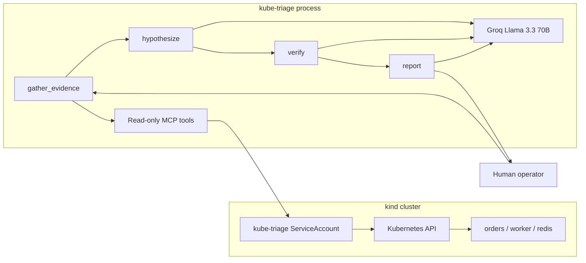

# kube-triage

Read-only AI agent that diagnoses a broken Kubernetes deployment and returns a typed report with evidence and a suggested fix — it never changes the cluster.

## Architecture



## 60-second quick start

```bash
python3 -m venv .venv
source .venv/bin/activate
pip install -e ".[dev]"
cp .env.example .env   # set GROQ_API_KEY
make cluster-up
make demo
```

`make demo` creates a kind cluster, deploys the sample app, injects `crashloop_bad_config`, runs the agent with the read-only kubeconfig, prints the JSON report, and restores the app.

## Demo app

`demo-app/` is a three-part workload written for this repo: a FastAPI `orders` API (`/health`, `/ready`, `/queue`, `POST /orders`), a Redis-backed worker, and Redis. Manifests include Deployment, Service, ConfigMap, probes, and resource requests/limits.

## Eval

`make eval` injects each fault five times, waits for symptoms, runs the agent, scores with rules (category + required evidence strings), restores, and writes `docs/results.md`.

No eval numbers are published in this README until `make eval` has been run in this checkout. See [docs/results.md](docs/results.md).

There is no LLM-as-judge score. If a judge is added later it will be a clearly labeled secondary column.

## Safety model

- **Read-only RBAC.** The agent uses a ServiceAccount bound to get/list/watch on pods, logs, events, deployments, configmaps, services, and endpoints. It has no Secrets access and no create/update/delete/patch.
- **Prove it.** `make rbac-check` runs `kubectl auth can-i` and fails if mutate or Secrets access is allowed.
- **Untrusted data.** Logs, events, and config are wrapped in `<<<UNTRUSTED_CLUSTER_DATA>>>` blocks. The model is instructed to treat them as observations, never as instructions.
- **No auto-remediation.** Output is a diagnosis, evidence citations, and a suggested fix as text or a unified diff.

## Limitations

- The agent only sees one namespace and the tools listed above.
- It cannot open a shell, port-forward, or query Prometheus.
- Groq rate limits (HTTP 429) are retried with backoff; persistent 429s fail the run.
- kind + Groq latency dominate eval wall-clock time.
- A kind-based GitHub Actions RBAC job is included; it can flake on image pulls or kind startup. Treat that job as infrastructure, not as model quality.

## Roadmap

- Recorded GIF/video in `docs/demo/`
- Optional traces exporter for tool-call timelines
- Extra faults only after they are reproducible on kind

## License

MIT © 2026 Hassnain Abbas
