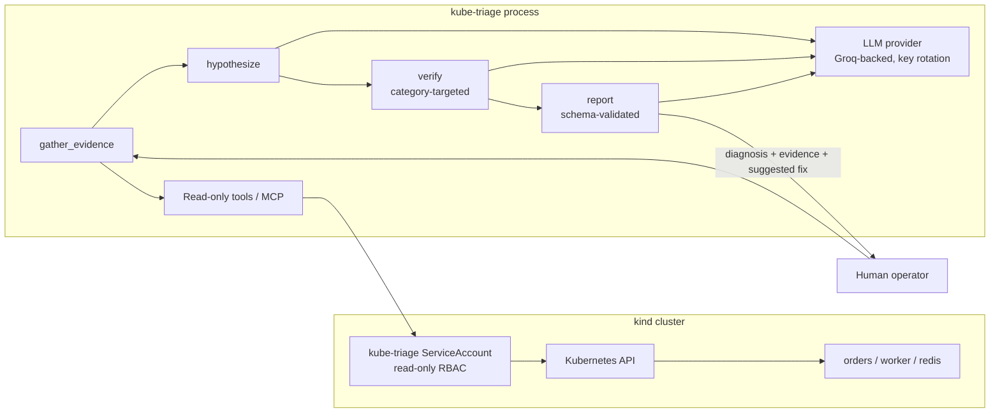

# kube-triage

[](https://github.com/Hassnain2003/kube-triage/actions/workflows/ci.yml)


A **read-only AI agent** that diagnoses broken Kubernetes deployments and returns a typed report — root cause, evidence, and a suggested fix (text or unified diff). It **never changes the cluster**.

**97% accuracy** (29/30, 5 runs × 6 faults) on a kind-based eval with rule-based scoring — real numbers from `make eval` recorded in [`docs/results.md`](docs/results.md).

## Highlights

- **97% diagnosis accuracy** across 6 real fault scenarios (CrashLoop, OOMKilled, ImagePull, readiness dependency down, wrong dependency URL, worker backlog) — 29/30 correct with cited evidence.
- **Strictly read-only**: enforced by Kubernetes RBAC (get/list/watch only, no Secrets, no create/update/delete/patch) and verified with `kubectl auth can-i`.
- **Prompt-injection aware**: logs/events/config are treated as untrusted data, never as instructions.
- **Transparent eval**: rule-based scoring (exact category + required evidence). No invented metrics — every number has command, date, model, and git commit.
- **MCP + LangGraph agent**: explicit `gather_evidence → hypothesize → verify → report` pipeline with tool-call budget and timeout.

## Architecture



## 60-second quick start

```bash
python3 -m venv .venv
source .venv/bin/activate
pip install -e ".[dev]"
cp .env.example .env   # set GROQ_API_KEYS (comma-separated) and GROQ_MODEL
make cluster-up
make demo
```

`make demo` creates a kind cluster, deploys the sample app, injects `crashloop_bad_config`, runs the agent with the read-only kubeconfig, prints the JSON report, and restores the app.

## Demo app

`demo-app/` is a three-part workload written for this repo: a FastAPI `orders` API (`/health`, `/ready`, `/queue`, `POST /orders`), a Redis-backed worker, and Redis. Manifests include Deployment, Service, ConfigMap, probes, and resource requests/limits.

## Eval (real, measured)

`make eval` injects each fault 5 times, waits for symptoms, runs the agent, scores with rules (category + required evidence strings), restores, and confirms the cluster is healthy before the next run. Results are written to [`docs/results.md`](docs/results.md).

**Latest measured run** (2026-11-09, commit `21cf659`, model `openai/gpt-oss-120b` via Groq, kind v0.30.0, 8 CPUs):

| Fault | Correct | Evidence | Mean tool calls | Mean sec | 429 retries |
| --- | --- | --- | --- | --- | --- |
| crashloop_bad_config | 4/5 | 4/5 | 15.8 | 25.6 | 23 |
| oomkilled | 5/5 | 5/5 | 18.8 | 31.8 | 27 |
| imagepull_wrong_tag | 5/5 | 5/5 | 17.4 | 41.6 | 33 |
| readiness_dependency_down | 5/5 | 5/5 | 19.6 | 26.9 | 32 |
| wrong_dependency_url | 5/5 | 5/5 | 21.0 | 37.6 | 40 |
| worker_backlog | 5/5 | 5/5 | 18.6 | 20.2 | 34 |
| **Overall** | **97% (29/30)** | **97%** | 18.5 | 30.6 | 189 |

Scoring is **rule-based** (exact `root_cause_category` + required evidence strings). No LLM-as-judge is used as a primary metric.

## Safety model

- **Read-only RBAC.** The agent uses a ServiceAccount bound to get/list/watch on pods, logs, events, deployments, configmaps, services, and endpoints. No Secrets access, no create/update/delete/patch.
- **Prove it.** `make rbac-check` runs `kubectl auth can-i` and fails if mutate or Secrets access is allowed.
- **Untrusted data.** Logs, events, and config are wrapped in `<<<UNTRUSTED_CLUSTER_DATA>>>` blocks and the model is instructed to treat them as observations, never as instructions.
- **No auto-remediation.** Output is a diagnosis, evidence citations, and a suggested fix (text or unified diff) for human review.

## Limitations

- Single-namespace view with the tools listed above (no shell, no port-forward, no Prometheus).
- LLM rate limits (HTTP 429) are retried with backoff and multi-key rotation; sustained TPD exhaustion can fail runs.
- Eval is measured against the configured model/provider (`GROQ_MODEL`). Results must be re-measured if the model changes. The provider interface is designed for Groq; `llama-3.3-70b-versatile` is the intended target when available on the key.
- 1/30 miss in the latest run was an `invalid_schema` report on a crashloop case; the rest of the categories were 5/5.
- kind + LLM latency dominate eval wall-clock time. The kind RBAC CI job can be flaky on infrastructure (image pulls/startup).

## Repo layout

- `src/kube_triage/` — agent (LangGraph), LLM provider, read-only tools, MCP server, redaction, eval harness
- `demo-app/` — FastAPI orders API, worker, Redis, Dockerfiles, k8s manifests + RBAC
- `eval/golden/` — ground-truth labels per fault
- `scripts/` — RBAC proof, triage kubeconfig
- `docs/results.md` — measured eval output

## License

MIT © 2026 Hassnain Abbas
